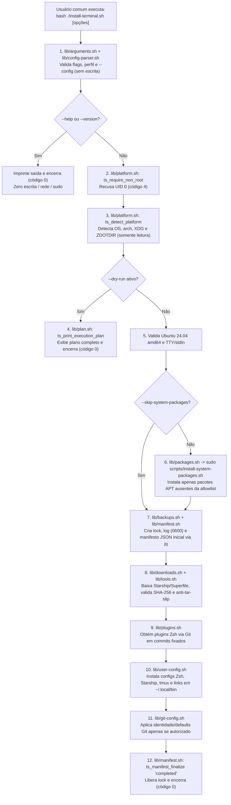

# Arquitetura do Projeto (`terminal-setup`)

Este documento descreve a arquitetura modular, o modelo de separação de privilégios, o fluxo de execução e a organização de arquivos do projeto `terminal-setup` para **Ubuntu 24.04 LTS (`amd64`)**, conforme as Seções 4, 5, 8 e 10 do guia de implementação.

---

## 1. Princípios arquiteturais

1. **Separação estrita de privilégios (`root` vs. usuário comum):**
   - O instalador principal ([`install-terminal.sh`](../install-terminal.sh)), o diagnóstico ([`doctor.sh`](../doctor.sh)) e o desinstalador ([`uninstall-terminal.sh`](../uninstall-terminal.sh)) executam exclusivamente como **usuário comum** (`UID != 0`). Se invocados como `root` (`UID 0`), `install-terminal.sh` e `uninstall-terminal.sh` abortam imediatamente com código `4` antes de qualquer escrita.
   - A instalação de pacotes do sistema via APT é isolada em um único helper administrativo: [`scripts/install-system-packages.sh`](../scripts/install-system-packages.sh). Esse helper exige `UID 0`, valida a plataforma (`Ubuntu 24.04 amd64`), aceita apenas pacotes de uma allowlist fechada e **jamais** toca em `$HOME`, dotfiles ou identidade Git.
2. **Planejamento puro sem efeito colateral (`--dry-run`, `--help`, `--version`):**
   - Toda validação de CLI, parsing restrito de `--config` (`CHAVE=valor` sem `source`/`eval`) e detecção de plataforma/caminhos ocorrem em memória antes de qualquer operação de disco, rede ou `sudo`.
   - Em `--dry-run`, nenhum diretório, arquivo temporário, log, backup ou manifesto é criado.
3. **Estado XDG auditável e reversível:**
   - Nenhum arquivo de estado, backup ou log é gravado na árvore do repositório.
   - Toda operação efetiva registra um manifesto JSON (`${XDG_STATE_HOME:-$HOME/.local/state}/terminal-setup/manifests/<install-id>.json`) gerado e validado exclusivamente via `jq`, com permissões privadas (`umask 077` / `0600`).
4. **Configuração modular de Zsh, Starship e tmux:**
   - Os módulos do Zsh ficam organizados em `${XDG_CONFIG_HOME:-$HOME/.config}/terminal-setup/zsh/*.zsh` e são carregados por `${ZDOTDIR:-$HOME}/.zshrc` em ordem determinística.
   - Nenhum alias invasivo substitui comandos tradicionais (`ls`, `cat`, `find`, `grep`, `cd`, `vi`, `vim`, `top`, `htop`).

---

## 2. Diagrama do fluxo de execução

---

## 3. Mapa de módulos e responsabilidades

| Arquivo / Diretório | Contexto de Execução | Papel na Arquitetura |
|---|---|---|
| [`install-terminal.sh`](../install-terminal.sh) | Usuário comum | Ponto de entrada principal; coordena preflight, plano, pacotes, ferramentas, plugins, dotfiles e manifesto. |
| [`doctor.sh`](../doctor.sh) | Usuário comum | Diagnóstico estritamente somente leitura (humano em PT-BR ou `--json` via `jq`). |
| [`uninstall-terminal.sh`](../uninstall-terminal.sh) | Usuário comum | Restauração de backups e remoção seletiva guiada exclusivamente pelo manifesto validado. |
| [`scripts/install-system-packages.sh`](../scripts/install-system-packages.sh) | `root` (`UID 0`) | Helper administrativo para instalar pacotes APT da allowlist no Ubuntu 24.04 `amd64`. |
| [`lib/common.sh`](../lib/common.sh) | Biblioteca interna | Constantes, códigos de saída, formatação (`NO_COLOR`), validação de strings e sanitização de hooks de teste. |
| [`lib/platform.sh`](../lib/platform.sh) | Biblioteca interna | Verificação de `UID != 0`, detecção de OS/arquitetura/WSL/container e validação de caminhos XDG/`ZDOTDIR`. |
| [`lib/config-parser.sh`](../lib/config-parser.sh) | Biblioteca interna | Parser restrito `CHAVE=valor` (sem `source` e sem `eval`) para `profiles/*.conf` e `--config`. |
| [`lib/arguments.sh`](../lib/arguments.sh) | Biblioteca interna | Catálogo de componentes, resolução de dependências, precedência (`defaults < --config < CLI`) e conflitos de flags. |
| [`lib/plan.sh`](../lib/plan.sh) | Biblioteca interna | Exibição detalhada do plano de execução sem efeitos colaterais. |
| [`lib/backups.sh`](../lib/backups.sh) | Biblioteca interna | Lock de concorrência, logs privados (`0600`), validação canônica de caminhos (`ts_validate_managed_path`), backups e escrita atômica. |
| [`lib/manifest.sh`](../lib/manifest.sh) | Biblioteca interna | Geração, leitura NUL-delimited e validação de propriedade/schema de manifestos JSON via `jq`. |
| [`lib/packages.sh`](../lib/packages.sh) | Biblioteca interna | Consulta `dpkg-query` e delegação segura ao helper APT via `sudo` (ou orientação em 2 etapas). |
| [`lib/downloads.sh`](../lib/downloads.sh) | Biblioteca interna | Download HTTPS via `curl`, verificação SHA-256 e inspeção anti-*tar-slip* (`ts_validate_tar_gz_archive`). |
| [`lib/tools.sh`](../lib/tools.sh) | Biblioteca interna | Instalação versionada de Starship e Superfile (`spf`) a partir de [`versions/tools.lock.json`](../versions/tools.lock.json). |
| [`lib/plugins.sh`](../lib/plugins.sh) | Biblioteca interna | Instalação de plugins Zsh em commits fixados de 40 caracteres a partir de [`versions/plugins.lock.json`](../versions/plugins.lock.json). |
| [`lib/user-config.sh`](../lib/user-config.sh) | Biblioteca interna | Instalação idempotente de `.zshenv`, `.zshrc`, `options.zsh`, módulos Zsh, `starship.toml`, `tmux.conf` e links `bat`/`fd`. |
| [`lib/git-config.sh`](../lib/git-config.sh) | Biblioteca interna | Configuração opcional e isolada de identidade e defaults globais do Git sem vazar dados pessoais em logs/manifesto. |

---

## 4. Ordem de carga dos arquivos Zsh no perfil do usuário

Quando o Zsh inicia como shell interativo:

1. **`${ZDOTDIR:-$HOME}/.zshenv`**: garante `${HOME}/.local/bin` no início do `PATH` e define variáveis XDG padrão sem imprimir texto e sem depender de TTY.
2. **`${ZDOTDIR:-$HOME}/.zshrc`**:
   - Configura histórico privado (`umask 077` para `~/.zsh_history`) e `compinit` com cache em `${XDG_CACHE_HOME:-$HOME/.cache}/zsh`;
   - Carrega `${XDG_CONFIG_HOME:-$HOME/.config}/terminal-setup/zsh/options.zsh` (`TS_ICONS_MODE` e `TS_VI_MODE_ENABLED`);
   - Carrega os módulos funcionais (`aliases.zsh`, `bindings.zsh`, `git.zsh`, `containers.zsh`, `database.zsh`, `fzf.zsh`);
   - Carrega `plugins.zsh`, que respeita a ordem crítica:
     1. `zsh-vi-mode` (apenas se `TS_VI_MODE_ENABLED=true`, com `ZVM_INIT_MODE=sourcing`);
     2. `zsh-autosuggestions`;
     3. `zsh-syntax-highlighting`;
     4. `zsh-history-substring-search` (por último, vinculando as teclas de seta para cima/baixo);
   - Carrega `prompt.zsh` (inicializa `starship init zsh` e `zoxide init zsh` quando disponíveis no `PATH`, sem chamadas de rede);
   - Por fim, se existir `${XDG_CONFIG_HOME:-$HOME/.config}/terminal-setup/local.zsh` (arquivo exclusivo do usuário), faz `source` dele para permitir customizações locais sem editar arquivos gerenciados.

